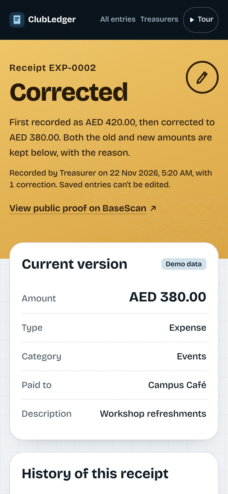
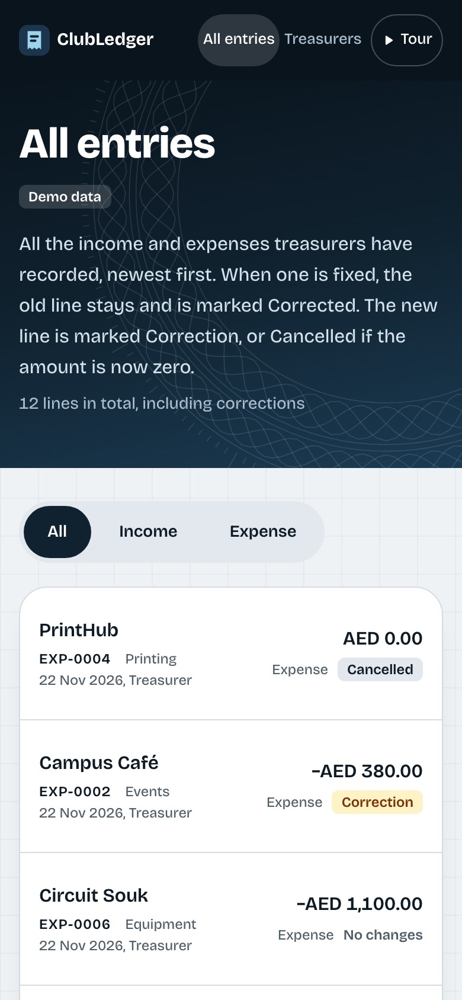
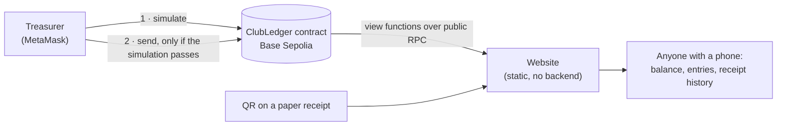

# ClubLedger

**Every dirham a student club spends, on a public record nobody can edit.**

Treasurers record the club's income and expenses on a smart contract. Anyone can check a receipt by its number, or by scanning the QR code printed on it, and see whether the record is genuine, corrected or cancelled. They need no wallet and no account. The contract itself refuses anything that breaks the club's rules, so neither the website nor the treasurers can bend them.

**Hash It Out 2026 · Track 4: Financial Transparency** · BITS Pilani Dubai · solo entry

| | |
|---|---|
| **Live site** | **https://clubledger-kappa.vercel.app** (press **Tour** for a one-minute walkthrough) |
| **Contract** | [`0x210312F9C553a02A9864CC9685854A72d49D4F7e`](https://sepolia.basescan.org/address/0x210312F9C553a02A9864CC9685854A72d49D4F7e#code) on Base Sepolia, source verified on [BaseScan](https://sepolia.basescan.org/address/0x210312F9C553a02A9864CC9685854A72d49D4F7e#code) and [Sourcify](https://sourcify.dev/server/v2/contract/84532/0x210312F9C553a02A9864CC9685854A72d49D4F7e) (exact match) |
| **Every transaction** | [DEPLOYMENT.md](DEPLOYMENT.md): deploy, seed, and a passed and a refused transaction for each rule |
| **Submission note** | [NOTE.md](NOTE.md) (users, on-chain vs off-chain, limits) · [WHO_DID_WHAT.md](WHO_DID_WHAT.md) |

<p align="center">
  
  &nbsp;
  
  &nbsp;
  
</p>

## Try it in two minutes

1. **Check a receipt.** Each opens a one-word result straight from the contract:
   [`EXP-0002`](https://clubledger-kappa.vercel.app/check/EXP-0002) Corrected ·
   [`EXP-0004`](https://clubledger-kappa.vercel.app/check/EXP-0004) Cancelled ·
   [`INC-0001`](https://clubledger-kappa.vercel.app/check/INC-0001) Genuine ·
   [`XYZ-1`](https://clubledger-kappa.vercel.app/check/XYZ-1) No such record
2. **Follow the money.** The [home page](https://clubledger-kappa.vercel.app) shows the balance, and its account book shows the balance after every line. [All entries](https://clubledger-kappa.vercel.app/ledger) lists every line, corrections included.
3. **Try to break a rule.** With MetaMask on Base Sepolia, open [Treasurers](https://clubledger-kappa.vercel.app/manage) and record an entry from any wallet. The contract refuses it, and the site explains why and links to a past refusal on BaseScan. Without a wallet, the refused transactions below show the same thing.
4. **Print and scan.** [`docs/receipts.html`](docs/receipts.html) prints three demo receipts. Their QR codes open the result page on a phone.

## The four rules, enforced by the contract

| Rule | Allowed | Refused on-chain |
|---|---|---|
| **1. Only authorised treasurers can record money.** Anyone else is refused, even the Club Advisor who appoints them. | [INC-0001 by the Treasurer](https://sepolia.basescan.org/tx/0xec9f42c3aee54860222a41fbdc8ee11d7fe9b0eaf7d12e4306751dc0fff9773d) | [A random wallet posts EXP-9001](https://sepolia.basescan.org/tx/0xd257bd631b24a9cc76984cabc3e6a0a90cc63a8818d7441089be5df9fb6ce540): `Not an authorised poster` |
| **2. The books can never go negative.** An expense or correction larger than the balance is refused. | [EXP-0001](https://sepolia.basescan.org/tx/0xb2e76df785986d8c6d34c6c2bda8d1cb39fe63ea6da12e3fd5846885980d3c8e) | [AED 50,000 expense](https://sepolia.basescan.org/tx/0x09a7394a12ace66719cd6039ab7888a9f550612ea62e7b6259c3f2395fa166dd): `Expense exceeds club balance` |
| **3. A receipt can only be recorded once.** | [INC-0001](https://sepolia.basescan.org/tx/0xec9f42c3aee54860222a41fbdc8ee11d7fe9b0eaf7d12e4306751dc0fff9773d) | [INC-0001 again](https://sepolia.basescan.org/tx/0xfc4b3fec2641bcde6acdbbebf34bc67dc20de5c8f1e21034e63397ba556bd8ba): `Reference code already used` |
| **4. No edits, only corrections.** A correction is a new linked entry with a reason; the original stays forever and can't be corrected twice. | [EXP-0002 corrected, AED 420 → 380](https://sepolia.basescan.org/tx/0xc46b612799926b6448845d8b3a033a44058c5cbae0d44f7c1f87c2df1375d7a9) | [The old EXP-0002 corrected again](https://sepolia.basescan.org/tx/0x292a91339f29dc1b3cdabc6b1ade0bfbfed476085e559f2016f555e4b305a96d): `Entry already corrected - correct the latest version` |

The contract has no edit or delete function, accepts no money (no `payable`, `receive` or `fallback`), makes no external calls and imports nothing.

## How it works



- **Contract** ([`contracts/src/ClubLedger.sol`](contracts/src/ClubLedger.sol)). Entries are append-only. A correction points at what it corrects, `versionsOf(receipt)` returns the whole chain, and the balance, money in and money out update in the same transaction.
- **Website** ([`frontend/`](frontend)). Vite, React, TypeScript, Tailwind, wagmi and viem. Public pages read the contract's view functions through two public RPCs (with fallback), batched through Multicall3. They use no wallet, no database and no event logs, so what you see is what the contract returns.
- **Writes** ([`frontend/src/lib/write.ts`](frontend/src/lib/write.ts)). Every action is simulated against the contract first. If the contract would refuse it, the treasurer sees **"Blocked by the club's rulebook"** in plain English with a link to a real refusal on BaseScan, instead of a raw error.
- **Money** is stored as whole fils (AED × 100) in `uint256` and handled as `bigint` in the browser. There is no floating point anywhere in money handling.

## Tests

| Suite | What it covers | Result |
|---|---|---|
| Foundry ([`contracts/test`](contracts/test)) | 28 unit tests, every revert string triggered; 3 invariants over 16,384 random calls (balance = income − expenses; totals match an independent model; no overspend or non-treasurer call is ever accepted) | 29 passed |
| Vitest ([`frontend/src/lib`](frontend/src/lib)) | Money parsing and formatting, the running balance, revert-reason mapping | 98 passed |
| Playwright ([`frontend/e2e`](frontend/e2e)) | The live site at phone and desktop sizes: every verdict, balances, proof links, layout shift, RPC failure, the guided tour, and a stand-in wallet that is never asked to send | 56 passed (5 local-only write tests skipped) |
| [`check-refusals.mjs`](frontend/scripts/check-refusals.mjs) | Simulates each refusal and one valid entry against the deployed contract; sends nothing | All passed |

```bash
cd contracts && forge test -vv
cd frontend && npm install && npm test
cd frontend && BASE_URL=https://clubledger-kappa.vercel.app npx playwright test
```

## Repository

```
contracts/
  src/ClubLedger.sol        the contract
  test/                     unit and invariant tests
  script/                   Deploy.s.sol, Seed.s.sol (the fictional demo data)
frontend/
  src/pages/                Home, Check (receipt result), Ledger, Manage (treasurers)
  src/lib/                  contract reads, write flow, money, refusal copy
  src/tour/                 the guided tour
  e2e/                      Playwright tests
  scripts/                  check-refusals, printable receipts, ABI sync
docs/receipts.html          printable demo receipts with QR codes
```

## Run it locally

```bash
cd frontend && npm install && npm run dev
```

To publish your own copy, put keys in `contracts/.env` (see [`.env.example`](contracts/.env.example)), run `Deploy.s.sol` and `Seed.s.sol` with `forge script … --broadcast`, and set `CONTRACT_ADDRESS` in [`frontend/src/config.ts`](frontend/src/config.ts).

## Limits

A treasurer can still type a lie, but can never hide or rewrite it. Matching the record against the bank account stays off-chain. There is a single admin key. All data is fictional and on a testnet. Details in [NOTE.md](NOTE.md).
