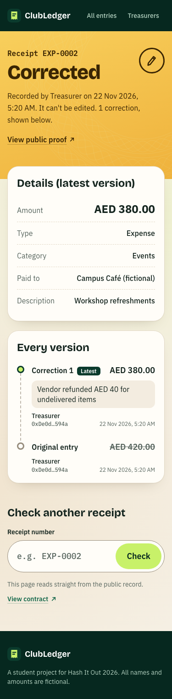

# ClubLedger — Robotics Club Money, every dirham on the record

A public money record for a student club. Authorised treasurers record income and expenses on a smart contract; **anyone can check any receipt by its number on a phone — no wallet** — and see a one-word verdict plus every version of it. Mistakes are fixed with corrections that never erase the original. The contract, not the website, refuses unauthorised wallets, overspending, duplicate receipts and edits.

**Hash It Out 2026 · Track 4: Financial Transparency** · BITS Pilani Dubai · solo entry

| | |
|---|---|
| Live site | **https://clubledger-kappa.vercel.app** |
| Contract (Base Sepolia) | [`0x210312F9C553a02A9864CC9685854A72d49D4F7e`](https://sepolia.basescan.org/address/0x210312F9C553a02A9864CC9685854A72d49D4F7e) |
| Verified source | [BaseScan: verified](https://sepolia.basescan.org/address/0x210312F9C553a02A9864CC9685854A72d49D4F7e#code) · [Sourcify: exact match](https://sourcify.dev/server/v2/contract/84532/0x210312F9C553a02A9864CC9685854A72d49D4F7e) |
| Try it | Check receipt [`EXP-0002`](https://clubledger-kappa.vercel.app/check/EXP-0002) (corrected) · [`EXP-0004`](https://clubledger-kappa.vercel.app/check/EXP-0004) (cancelled) · [`INC-0001`](https://clubledger-kappa.vercel.app/check/INC-0001) (genuine) |
| All transactions | [DEPLOYMENT.md](DEPLOYMENT.md) |
| One-page note | [NOTE.md](NOTE.md) · [WHO_DID_WHAT.md](WHO_DID_WHAT.md) |

<p align="center"></p>

## The 4 rules the contract enforces

Each rule has a real ✓ passed and ✗ refused transaction on BaseScan (linked on the home page and in [DEPLOYMENT.md](DEPLOYMENT.md)).

1. **Only authorised treasurers can record money.** Anyone else is refused — even the Club Advisor (admin).
2. **The books can never go negative.** An expense larger than the recorded balance is refused.
3. **A receipt can only be recorded once.** Duplicate receipt numbers are refused.
4. **Corrections, never edits.** A correction is a new linked entry; the original stays forever; an already-corrected version can't be corrected again.

## How it works

- `contracts/` — Foundry project, Solidity 0.8.24, no imports, no payable functions. Entries are append-only; `correctedBy` links each version to its correction; `versionsOf(receipt)` returns the whole chain.
- `frontend/` — Vite + React + TypeScript + Tailwind + wagmi/viem. Public pages (`/`, `/check/:code`, `/ledger`) read the contract's view functions through public RPCs — no wallet, no backend, no event logs. `/manage` connects MetaMask, checks every action against the contract first (simulation), and if the contract would refuse it shows a plain-English **"Blocked by the club's rulebook"** card linking to the matching public refusal.
- `docs/receipts.html` — printable demo receipts with QR codes that open the verdict page.

## Run the tests

```bash
cd contracts && forge test -vv          # 28 unit tests + invariant suite (balance == income − expense; no negative state ever accepted)
cd frontend && npm install && npm test  # money parsing + revert-reason mapping (Vitest)
cd frontend && BASE_URL=https://clubledger-kappa.vercel.app npx playwright test   # live site checks at 375 px (sends nothing; the local-only write suite is skipped)
cd frontend && node scripts/check-refusals.mjs   # simulates the 4 refusals + a valid post against the deployed contract (sends nothing)
```

## Run locally

```bash
cd frontend && npm install && npm run dev
```

Deploying your own copy: put keys in `contracts/.env` (see `.env.example`), then `forge script script/Deploy.s.sol --rpc-url $BASE_SEPOLIA_RPC --broadcast --verify` and `forge script script/Seed.s.sol --rpc-url $BASE_SEPOLIA_RPC --broadcast`, and set `CONTRACT_ADDRESS` in `frontend/src/config.ts`.

## Limits

A treasurer can still type a lie — but can never hide or rewrite it. Bank reconciliation stays off-chain. Single admin key. Synthetic data only, testnet only. See [NOTE.md](NOTE.md).
