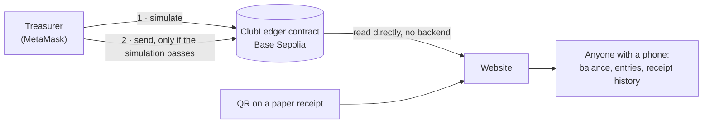

# ClubLedger

### Every dirham a student club spends, on a public record nobody can edit.

**Hash It Out 2026 · Track 4: Financial Transparency · BITS Pilani Dubai · solo entry**

 

 

## The problem

A student club's money lives in a treasurer's spreadsheet. Members can't see it, sponsors have to take it on trust, and a quiet edit leaves no trace.

**ClubLedger puts every entry on a public smart contract.** Anyone can look up a receipt by its number, or scan the QR code printed on it, and see in one word whether it is genuine, corrected or cancelled. They need no wallet and no account. Mistakes are fixed with corrections that keep the original forever, and the contract itself refuses anything that breaks the club's rules, so nobody can bend them: not the treasurers, not the advisor, not the website.

  
  &nbsp;&nbsp;
  
  &nbsp;&nbsp;
  
   
  <b>A receipt's history</b> &nbsp;·&nbsp; <b>A refusal by the contract</b> &nbsp;·&nbsp; <b>Every entry, corrections included</b>

## Try it in two minutes

| | |
|---|---|
| **1 · Take the tour** | Open the [live site](https://clubledger-kappa.vercel.app) and press **Tour** for a one-minute walkthrough. |
| **2 · Check a receipt** | [`EXP-0002`](https://clubledger-kappa.vercel.app/check/EXP-0002) Corrected · [`EXP-0004`](https://clubledger-kappa.vercel.app/check/EXP-0004) Cancelled · [`INC-0001`](https://clubledger-kappa.vercel.app/check/INC-0001) Genuine · [`XYZ-1`](https://clubledger-kappa.vercel.app/check/XYZ-1) No such record |
| **3 · Follow the money** | The home page's account book shows the balance after every line, down to today's total. [All entries](https://clubledger-kappa.vercel.app/ledger) lists everything, corrections included. |
| **4 · Try to break a rule** | With MetaMask on Base Sepolia, open [Treasurers](https://clubledger-kappa.vercel.app/manage) and record an entry from any wallet. The contract refuses it, and the site explains why. |
| **5 · Scan a paper receipt** | [`docs/receipts.html`](docs/receipts.html) prints three demo receipts whose QR codes open their record on a phone. |

## The four rules, proven on-chain

Each rule has a real transaction that passed and a real one the contract refused.

| Rule | ✅ Allowed | ⛔ Refused by the contract |
|---|---|---|
| **1. Only authorised treasurers can record money.** Anyone else is refused, even the Club Advisor who appoints them. | [INC-0001 by the Treasurer](https://sepolia.basescan.org/tx/0xec9f42c3aee54860222a41fbdc8ee11d7fe9b0eaf7d12e4306751dc0fff9773d) | [A random wallet posts EXP-9001](https://sepolia.basescan.org/tx/0xd257bd631b24a9cc76984cabc3e6a0a90cc63a8818d7441089be5df9fb6ce540) `Not an authorised poster` |
| **2. The books can never go negative.** An expense or correction larger than the balance is refused. | [EXP-0001](https://sepolia.basescan.org/tx/0xb2e76df785986d8c6d34c6c2bda8d1cb39fe63ea6da12e3fd5846885980d3c8e) | [An AED 50,000 expense](https://sepolia.basescan.org/tx/0x09a7394a12ace66719cd6039ab7888a9f550612ea62e7b6259c3f2395fa166dd) `Expense exceeds club balance` |
| **3. A receipt can only be recorded once.** | [INC-0001](https://sepolia.basescan.org/tx/0xec9f42c3aee54860222a41fbdc8ee11d7fe9b0eaf7d12e4306751dc0fff9773d) | [INC-0001 again](https://sepolia.basescan.org/tx/0xfc4b3fec2641bcde6acdbbebf34bc67dc20de5c8f1e21034e63397ba556bd8ba) `Reference code already used` |
| **4. No edits, only corrections.** A correction is a new linked entry with a reason; the original stays forever and can't be corrected twice. | [EXP-0002 corrected, AED 420 → 380](https://sepolia.basescan.org/tx/0xc46b612799926b6448845d8b3a033a44058c5cbae0d44f7c1f87c2df1375d7a9) | [The old EXP-0002 corrected again](https://sepolia.basescan.org/tx/0x292a91339f29dc1b3cdabc6b1ade0bfbfed476085e559f2016f555e4b305a96d) `Entry already corrected - correct the latest version` |

The contract has no edit or delete function, accepts no money, makes no external calls and imports nothing. Every deploy, seed and proof transaction is listed in [DEPLOYMENT.md](DEPLOYMENT.md).

## Who uses it

| | |
|---|---|
| 🧾 **Treasurer and Asst. Treasurer** | Record money in and out from a browser wallet, and fix mistakes with corrections. |
| 🎓 **Club Advisor (admin)** | Approves and removes treasurers. Deliberately *cannot* record money: separation of duties. |
| 👥 **Members** | Check any receipt by its number, or scan the QR on a printed receipt. No wallet, no sign-up. |
| 🤝 **Sponsors and Student Council** | See exactly where their money went, and that nobody quietly changed it. |

## What's on the public record, and what isn't

| On the contract (public, permanent) | Off-chain |
|---|---|
| Every entry: type, amount, category, who was paid, description | The paper receipts and invoices themselves |
| Receipt numbers, each usable once | The club's bank account and reconciliation |
| Which wallet recorded it, and when | How the website looks (it only *reads* the record) |
| Every correction, linked to what it corrects, with a reason | Who the people behind the wallets are |
| Current and former treasurers | |
| The balance, money in and money out | |

## How it works

- **The contract** ([`ClubLedger.sol`](contracts/src/ClubLedger.sol)) is append-only. A correction points at what it corrects, `versionsOf(receipt)` returns the whole chain, and the balance, money in and money out change in the same transaction.
- **The website** reads the contract's own view functions through two public RPCs, with a fallback. It has no database and no server of its own, so what you see is exactly what the contract returns.
- **Every write is checked first.** The site simulates each action against the contract. If the contract would refuse it, the treasurer sees **"Blocked by the club's rulebook"** in plain English, with a link to a real refusal on BaseScan, instead of a raw error.
- **Money is whole fils** (AED × 100) in `uint256`, and `bigint` in the browser. There is no floating point anywhere in money handling.

<b>Stack</b>

 

Solidity 0.8.24 with Foundry · React 19, TypeScript, Vite and Tailwind CSS · wagmi and viem · Base Sepolia · Vercel

## Tested

| Suite | What it covers | Result |
|---|---|---|
| **Foundry** | 28 unit tests that trigger every revert message; 3 invariants over 16,384 random calls: the balance always equals income minus expenses, totals match an independent model, and no overspend or non-treasurer entry is ever accepted | ✅ 29 passed |
| **Vitest** | Money parsing and formatting, the running balance, and the plain-English refusal messages | ✅ 98 passed |
| **Playwright** | The live site at phone and desktop sizes: every receipt result, balances, proof links, layout stability, a public RPC going down, the guided tour, and a stand-in wallet that is never asked to send | ✅ 56 passed |
| **Live contract check** | Simulates each refusal and one valid entry against the deployed contract, sending nothing | ✅ All passed |

## Limits, honestly

- **A treasurer can still type a lie,** but can never hide it or rewrite it afterwards. Every change is a visible correction with a reason.
- **Matching with the bank stays off-chain.** The contract records what the treasurer declares; it can't see the bank.
- **There is a single admin key.** If the Club Advisor's key is lost, so is treasurer management (there is deliberately no admin transfer at this scope). The advisor can't post, but the contract can't tell whether a wallet they approve is secretly their own. That approval is public, though.
- **All data is fictional and on a testnet.** The club, vendors and sponsors are made up, and no real money moves.

 

**Solo project by Aryesh** · [Who did what](WHO_DID_WHAT.md) · [All transactions](DEPLOYMENT.md)

