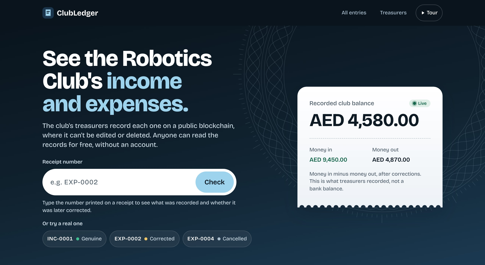
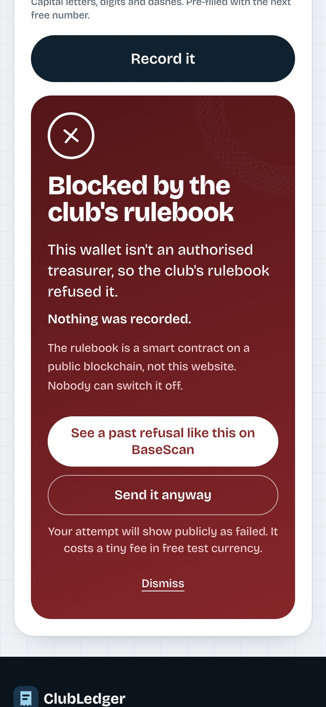
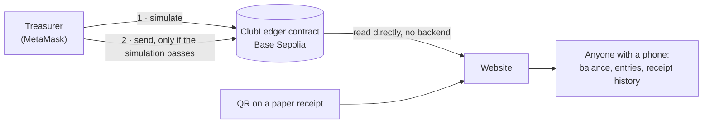

<div align="center">


# ClubLedger

### Every dirham a student club spends, on a public record nobody can edit.

[](https://clubledger-kappa.vercel.app)
[](https://sepolia.basescan.org/address/0x210312F9C553a02A9864CC9685854A72d49D4F7e#code)
[](https://sepolia.basescan.org/address/0x210312F9C553a02A9864CC9685854A72d49D4F7e)


**Hash It Out 2026 · Track 4: Financial Transparency · BITS Pilani Dubai · solo entry**

<br />

<a href="https://clubledger-kappa.vercel.app"></a>

</div>

<br />

<p align="center">
<a href="#deliverables">Deliverables</a> ·
<a href="#the-problem">The problem</a> ·
<a href="#proof-its-real">Proof</a> ·
<a href="#one-page-note">One-page note</a> ·
<a href="#how-it-works">How it works</a> ·
<a href="#the-contract-in-detail">The contract</a> ·
<a href="#tested">Tests</a> ·
<a href="#run-it-yourself">Run it yourself</a> ·
<a href="#repository-layout">Layout</a> ·
<a href="#limits-honestly">Limits</a>
</p>

## Deliverables

| | |
|---|---|
| **Live site** | https://clubledger-kappa.vercel.app (no wallet or account needed) |
| **Smart contract** | [`0x210312F9C553a02A9864CC9685854A72d49D4F7e`](https://sepolia.basescan.org/address/0x210312F9C553a02A9864CC9685854A72d49D4F7e#code), Base Sepolia, source verified on BaseScan |
| **Two transactions** | [Treasurer records INC-0001](https://sepolia.basescan.org/tx/0xec9f42c3aee54860222a41fbdc8ee11d7fe9b0eaf7d12e4306751dc0fff9773d) · [Treasurer corrects EXP-0002, AED 420 → 380](https://sepolia.basescan.org/tx/0xc46b612799926b6448845d8b3a033a44058c5cbae0d44f7c1f87c2df1375d7a9) ([details](#proof-its-real)) |
| **One-page note** | [Below](#one-page-note): the user and their task, on the blockchain, only on the page, what the contract refuses, how to run it, path to real life |
| **Who did what** | [WHO_DID_WHAT.md](WHO_DID_WHAT.md) |
| **Pitch deck** | [ClubLedger-pitch.pdf](docs/ClubLedger-pitch.pdf) (12 slides, five minutes) |
| **Supporting files** | [Google Drive folder](https://drive.google.com/drive/folders/1kTyOnfzaNDF6FBFvsFj_1hpU8FcjUyrZ) with the pitch deck |
| **Source code** | Contract: [`contracts/src/ClubLedger.sol`](contracts/src/ClubLedger.sol) · Tests: [`contracts/test/`](contracts/test) · Website: [`frontend/`](frontend) · [Repository layout](#repository-layout) · [Run it yourself](#run-it-yourself) |
| **Tests** | [185 passing](#tested): Foundry unit and invariant tests, Vitest, Playwright |
| **Contract reference** | [Every function, who can call it and every refusal message](#the-contract-in-detail) |
| **Every transaction** | [DEPLOYMENT.md](DEPLOYMENT.md), including the refused ones |

## The problem

A student club's money lives in a treasurer's spreadsheet. Members can't see it, sponsors have to take it on trust, and a quiet edit leaves no trace.

**ClubLedger puts every entry on a public smart contract.** Anyone can look up a receipt by its number, or scan the QR code printed on it, and see in one word whether it is genuine, corrected or cancelled. They need no wallet and no account. Mistakes are fixed with corrections that keep the original forever, and the contract itself refuses anything that breaks the club's rules, so nobody can bend them: not the treasurers, not the advisor, not the website.

<div align="center">
  
  &nbsp;&nbsp;
  
  &nbsp;&nbsp;
  
  <br />
  <sub><b>A receipt's history</b> &nbsp;·&nbsp; <b>A refusal by the contract</b> &nbsp;·&nbsp; <b>Every entry, corrections included</b></sub>
</div>

## Proof it's real

| | |
|---|---|
| **Contract** | [`0x210312F9C553a02A9864CC9685854A72d49D4F7e`](https://sepolia.basescan.org/address/0x210312F9C553a02A9864CC9685854A72d49D4F7e#code) on Base Sepolia, source verified |
| **Transaction 1** | The Treasurer records receipt INC-0001, a AED 5,000 sponsorship: [`0xec9f42c3…`](https://sepolia.basescan.org/tx/0xec9f42c3aee54860222a41fbdc8ee11d7fe9b0eaf7d12e4306751dc0fff9773d) |
| **Transaction 2** | The Treasurer corrects receipt EXP-0002 from AED 420 to 380, with the reason "Vendor refunded AED 40 for undelivered items": [`0xc46b6127…`](https://sepolia.basescan.org/tx/0xc46b612799926b6448845d8b3a033a44058c5cbae0d44f7c1f87c2df1375d7a9) |

Open [EXP-0002 on the live site](https://clubledger-kappa.vercel.app/check/EXP-0002) to see the second one from a member's side. Every other transaction, including the refused ones, is in [DEPLOYMENT.md](DEPLOYMENT.md).

## One-page note

### 1. The user and their one task

**A club member who wants to know the club's money was handled honestly.** Their one task: type or scan the number on a receipt and see, in one word, whether the record is **genuine, corrected or cancelled**, with every version, who recorded it and when. No wallet, no account, no explanation needed.

The record is kept by three roles:

| | |
|---|---|
| 🎓 **Club Advisor (admin)** | Approves and removes treasurers. Deliberately *cannot* record money: separation of duties. |
| 🧾 **Treasurer and Asst. Treasurer (operators)** | Record money in and out with their own wallet, and fix mistakes with corrections. |
| 👥 **Members, sponsors and the Student Council (public readers)** | Check any receipt, follow the balance, and see that nobody quietly changed anything. |

### 2. On the blockchain

| Stored in the contract (public, permanent) | Kept off the chain |
|---|---|
| Every entry: money in or out, amount, category, who was paid, description | The paper receipts and invoices themselves |
| Receipt numbers, each usable once | The club's bank account |
| Which wallet recorded each entry, and when | Who the people behind the wallets are |
| Every correction, linked to what it corrects, with its reason | |
| Current and former treasurers, with their role label | |
| The balance, total money in and total money out | |

### 3. Only on the page

The website stores nothing. It reads the contract and works these out by itself:

- **The one-word result** for a receipt (Genuine, Corrected, Cancelled or No such record), from that receipt's chain of versions.
- **The balance after every line** of the account book, replayed from the entries, so a member can follow the money to today's total.
- **Plain-English refusals.** Before anything is sent, the page asks the contract whether it would accept it, and turns a refusal like `Not an authorised poster` into a sentence anyone can read.
- **The paper receipts,** shown on [Sample receipts](https://clubledger-kappa.vercel.app/receipts) only to compare with the record. Paper never goes on the chain.
- **Friendly formatting:** AED amounts from whole fils, dates, role labels instead of bare addresses, the next free receipt number, the guided tour and the "Demo data" markers.

### 4. What the contract refuses

These hold for everyone, including the treasurers, the advisor and whoever runs the website. Each has a real transaction that passed and a real one the contract refused:

| Rule | ✅ Allowed | ⛔ Refused by the contract |
|---|---|---|
| **1. Only authorised treasurers can record money.** Anyone else is refused, even the Club Advisor who appoints them. | [INC-0001 by the Treasurer](https://sepolia.basescan.org/tx/0xec9f42c3aee54860222a41fbdc8ee11d7fe9b0eaf7d12e4306751dc0fff9773d) | [A random wallet posts EXP-9001](https://sepolia.basescan.org/tx/0xd257bd631b24a9cc76984cabc3e6a0a90cc63a8818d7441089be5df9fb6ce540)<br/><sub>`Not an authorised poster`</sub> |
| **2. The books can never go negative.** An expense or correction larger than the balance is refused. | [EXP-0001](https://sepolia.basescan.org/tx/0xb2e76df785986d8c6d34c6c2bda8d1cb39fe63ea6da12e3fd5846885980d3c8e) | [An AED 50,000 expense](https://sepolia.basescan.org/tx/0x09a7394a12ace66719cd6039ab7888a9f550612ea62e7b6259c3f2395fa166dd)<br/><sub>`Expense exceeds club balance`</sub> |
| **3. A receipt can only be recorded once.** | [INC-0001](https://sepolia.basescan.org/tx/0xec9f42c3aee54860222a41fbdc8ee11d7fe9b0eaf7d12e4306751dc0fff9773d) | [INC-0001 again](https://sepolia.basescan.org/tx/0xfc4b3fec2641bcde6acdbbebf34bc67dc20de5c8f1e21034e63397ba556bd8ba)<br/><sub>`Reference code already used`</sub> |
| **4. No edits, only corrections.** A correction is a new linked entry with a reason; the original stays forever and can't be corrected twice. | [EXP-0002 corrected, AED 420 → 380](https://sepolia.basescan.org/tx/0xc46b612799926b6448845d8b3a033a44058c5cbae0d44f7c1f87c2df1375d7a9) | [The old EXP-0002 corrected again](https://sepolia.basescan.org/tx/0x292a91339f29dc1b3cdabc6b1ade0bfbfed476085e559f2016f555e4b305a96d)<br/><sub>`Entry already corrected - correct the latest version`</sub> |

The advisor's role has its own rules too: only the advisor can approve or remove treasurers (`Only the admin can manage posters`), and the advisor can't make themselves a treasurer (`Admin cannot be a poster`). The contract has no edit or delete function, accepts no money and makes no external calls.

### 5. How to run it

Nothing to install. Open **https://clubledger-kappa.vercel.app** on a phone or laptop.

| | |
|---|---|
| **1 · Take the tour** | Press **Tour** in the top corner for a one-minute walkthrough. |
| **2 · Check a receipt** | [`EXP-0002`](https://clubledger-kappa.vercel.app/check/EXP-0002) Corrected · [`EXP-0004`](https://clubledger-kappa.vercel.app/check/EXP-0004) Cancelled · [`INC-0001`](https://clubledger-kappa.vercel.app/check/INC-0001) Genuine · [`XYZ-1`](https://clubledger-kappa.vercel.app/check/XYZ-1) No such record |
| **3 · Follow the money** | The home page's account book shows the balance after every line. [All entries](https://clubledger-kappa.vercel.app/ledger) lists everything, corrections included. |
| **4 · Try to break a rule** | With MetaMask on Base Sepolia, open [Treasurers](https://clubledger-kappa.vercel.app/manage) and record an entry from any wallet. The contract refuses it, and the site explains why. |
| **5 · Compare paper with the record** | [Sample receipts](https://clubledger-kappa.vercel.app/receipts) shows three paper receipts beside what the contract recorded. The café's says AED 420; the record says Corrected, AED 380, with the reason. Scan a QR code with a phone, or print them. |

### 6. Path to real life

**A shared spreadsheet can be edited, or rows deleted, by whoever controls it, and nobody else can tell; here nobody can rewrite the record, and the rules hold even against the treasurer and the advisor.** For real use, personal data stays off the chain: a student being repaid appears only as a code such as `S-014`, receipts and invoices stay in the club's files with just their number on the record, and wallets stand for roles, not named people. The university's Student Activities office would run it as the Club Advisor, with each club's elected treasurers as operators and members checking from their phones.

## How it works



- **The contract** ([`ClubLedger.sol`](contracts/src/ClubLedger.sol)) is append-only. A correction points at what it corrects, `versionsOf(receipt)` returns the whole chain, and the balance, money in and money out change in the same transaction.
- **The website** reads the contract's own view functions through two public RPCs, with a fallback. It has no database and no server of its own, so what you see is exactly what the contract returns.
- **Every write is checked first.** The site simulates each action against the contract. If the contract would refuse it, the treasurer sees **"Blocked by the club's rulebook"** in plain English, with a link to a real refusal on BaseScan, instead of a raw error.
- **Money is whole fils** (AED × 100) in `uint256`, and `bigint` in the browser. There is no floating point anywhere in money handling.

<details>
<summary><b>Stack</b></summary>
<br />

Solidity 0.8.24 with Foundry · React 19, TypeScript, Vite and Tailwind CSS · wagmi and viem · Base Sepolia · Vercel

</details>

## The contract in detail

[`ClubLedger.sol`](contracts/src/ClubLedger.sol) is about 270 lines, with no imports and no dependencies. Amounts are AED in fils (AED × 100).

### Functions

| Function | Who can call it | What it does |
|---|---|---|
| `authorizePoster(who, label)` | Club Advisor only | Makes a wallet a treasurer with a role label such as "Treasurer". Refuses the zero address, the advisor's own wallet, an existing treasurer, and labels outside 1–32 bytes. |
| `revokePoster(who)` | Club Advisor only | Removes a treasurer. Their label is kept, so their past entries still say who recorded them. |
| `postEntry(kind, amount, category, counterparty, description, refCode)` | Current treasurers | Records money in or out. The amount must be above zero; the receipt number must be 1–16 characters of `A–Z`, `0–9` and `-` and never used before; and an expense can never be larger than the balance. |
| `correctEntry(entryId, newAmount, category, counterparty, description, reason)` | Current treasurers | Adds a new version linked to the latest one, with a reason of 1–140 bytes. An amount of 0 cancels the entry. The receipt number and money in/out are inherited, so they can't be changed, and the result can never make the balance negative. |
| `versionsOf(refCode)` | Anyone, free | Every version of a receipt, original first. This is what the receipt checker reads. |
| `getEntry(id)` · `getEntries(startId, count)` | Anyone, free | One entry, or a page of up to 50. |
| `summary()` | Anyone, free | Club name, advisor, balance, money in, money out and entry count, in one call. |
| `entryCount()` · `isPoster(addr)` · `posterLabel(addr)` · `balance()` | Anyone, free | Single values the website reads. |

### What each entry stores

| Field | Type | Meaning |
|---|---|---|
| `id` | `uint256` | 1, 2, 3… with no gaps. Entries are never removed. |
| `kind` | `Income` or `Expense` | Money in or out. |
| `amount` | `uint256` | AED in fils. 0 only in a correction, meaning cancelled. |
| `category` · `counterparty` · `description` | `string` | 1–32, 0–64 and 0–280 bytes. |
| `refCode` | `string` | The receipt number. A correction inherits it. |
| `poster` · `timestamp` | `address` · `uint64` | Which wallet recorded it, and when. Set by the contract, not the caller. |
| `correctsId` | `uint256` | 0 for an original; otherwise the version this one corrects. |
| `reason` | `string` | Empty for originals; required for corrections. |

### How corrections stay honest

- `entries[]` only ever grows. There is no function that edits or deletes it.
- `idByRef[keccak256(receipt)]` points at the original entry, and `correctedBy[id]` points at the version that replaced it. `versionsOf` follows that chain to the latest version.
- Only the latest version can be corrected (`Entry already corrected - correct the latest version`), so every receipt has one straight history with no forks.
- The balance, money in and money out change in the same transaction as the entry, and are checked before anything is stored. An invariant test confirms the balance always equals money in minus money out.

### Safety by design

- **It can't hold money.** No `payable` functions and no `receive` or `fallback`, so ETH sent to it is rejected.
- **Nothing to call back into.** It makes no external calls and imports no other code.
- **Separation of duties.** The advisor appoints treasurers but can never be one (`Admin cannot be a poster`).
- **Overflow-safe.** Solidity 0.8.24's built-in checked arithmetic, with no `unchecked` blocks.
- **Verified.** Compiled with the optimizer (200 runs, via-IR). The source is [verified on BaseScan](https://sepolia.basescan.org/address/0x210312F9C553a02A9864CC9685854A72d49D4F7e#code) and an [exact match on Sourcify](https://sourcify.dev/server/v2/contract/84532/0x210312F9C553a02A9864CC9685854A72d49D4F7e).
- **Events are for explorers only.** It emits `PosterAuthorized`, `PosterRevoked`, `EntryPosted` and `EntryCorrected`, but the website never relies on them: it reads the contract's current state through view functions.

<details>
<summary><b>Every refusal message, and when it happens</b></summary>
<br />

| Message | When |
|---|---|
| `Only the admin can manage posters` | Anyone but the advisor tries to add or remove a treasurer |
| `Invalid address` | Adding the zero address as a treasurer |
| `Admin cannot be a poster` | The advisor tries to make their own wallet a treasurer |
| `Already a poster` | Adding a wallet that is already a treasurer |
| `Invalid label` | A role label that is empty or over 32 bytes |
| `Not a poster` | Removing a wallet that isn't a treasurer |
| `Not an authorised poster` | Anyone but a current treasurer records or corrects money |
| `Amount must be greater than zero` | A new entry for 0 |
| `Invalid reference code` | A receipt number that is empty, too long, or uses other characters |
| `Reference code already used` | A receipt number recorded before |
| `Invalid category` | A category that is empty or over 32 bytes |
| `Text too long` | A counterparty, description or reason over its limit |
| `Expense exceeds club balance` | An expense larger than the balance |
| `Entry does not exist` | Correcting or reading an id that isn't there |
| `Entry already corrected - correct the latest version` | Correcting an older version |
| `Reason required` | A correction with no reason |
| `Correction would make balance negative` | A correction that would take the balance below zero |

Each one is triggered by a Foundry test, and the website turns each into a plain-English sentence ([`refusals.ts`](frontend/src/lib/refusals.ts)).

</details>

## Tested

| Suite | What it covers | Result |
|---|---|---|
| **Foundry** | 28 unit tests that trigger every revert message; 3 invariants over 16,384 random calls: the balance always equals income minus expenses, totals match an independent model, and no overspend or non-treasurer entry is ever accepted | ✅ 29 passed |
| **Vitest** | Money parsing and formatting, the running balance, and the plain-English refusal messages | ✅ 98 passed |
| **Playwright** | The live site at phone and desktop sizes: every receipt result, balances, proof links, layout stability, a public RPC going down, the guided tour, and a stand-in wallet that is never asked to send | ✅ 58 passed |
| **Live contract check** | Simulates each refusal and one valid entry against the deployed contract, sending nothing | ✅ All passed |

## Run it yourself

You need **Node 22** and **[Foundry](https://getfoundry.sh)**. The website reads the deployed contract, so you need no keys or wallet to run it.

```bash
git clone --recurse-submodules https://github.com/AryB16/clubledger.git
cd clubledger
```

**Contract: build and test**

```bash
cd contracts
forge build
forge test -vv                               # 28 unit tests + 3 invariants
forge test --match-contract Invariant -vv    # the invariants alone: 256 runs × 64 calls
```

**Website: run and test**

```bash
cd frontend
npm ci
npm run dev                                  # http://localhost:5173
npm test                                     # Vitest unit tests
npx playwright install chromium
BASE_URL=https://clubledger-kappa.vercel.app npm run e2e    # browser tests against the live site
```

<details>
<summary><b>Deploy your own copy on Base Sepolia</b></summary>
<br />

1. `cp contracts/.env.example contracts/.env` and fill it in: an RPC URL, a BaseScan API key, and four **throwaway testnet** wallets (advisor, treasurer, assistant treasurer, random member) funded with Base Sepolia test ETH. Never use a real wallet. `.env` is git-ignored.
2. From `contracts/`, load it with `set -a; source .env; set +a`, then deploy and verify: `forge script script/Deploy.s.sol --rpc-url $BASE_SEPOLIA_RPC --broadcast --verify`
3. Put the printed address in `CLUBLEDGER_ADDRESS`, then add the demo data: `forge script script/Seed.s.sol --rpc-url $BASE_SEPOLIA_RPC --broadcast`
4. Set `CONTRACT_ADDRESS` in [`frontend/src/config.ts`](frontend/src/config.ts), the only place the address lives. If you changed the contract, run `npm run sync-abi`.
5. Check that the refusals work without sending anything: `node frontend/scripts/check-refusals.mjs`

</details>

## Repository layout

```text
contracts/
  src/ClubLedger.sol                 the contract
  test/ClubLedger.t.sol              28 unit tests, one or more for every refusal message
  test/ClubLedger.invariant.t.sol    3 invariants over 16,384 random calls
  script/Deploy.s.sol, Seed.s.sol    deployment and the fictional demo data
frontend/
  src/config.ts                      contract address, chain and RPCs (the only place)
  src/proofs.ts                      the real transaction hashes behind the proof links
  src/lib/money.ts                   AED text ⇄ whole fils as bigint, no floating point
  src/lib/ledger.ts                  reads from the contract and the one-word verdict
  src/lib/book.ts                    the running balance after every line
  src/lib/refusals.ts                refusal messages in plain English
  src/lib/write.ts                   simulate first, send only if the contract would accept
  src/lib/client.ts                  public RPCs with automatic fallback
  src/pages/                         Home, Check a receipt, All entries, Treasurers, Sample receipts
  src/tour/                          the one-minute guided tour
  e2e/                               Playwright browser tests
  scripts/check-refusals.mjs         simulates every refusal against the live contract, sends nothing
docs/                                screenshots, receipt QR codes, the pitch deck
DEPLOYMENT.md                        every transaction, including the refused ones
WHO_DID_WHAT.md                      who did what
```

## Limits, honestly

- **A treasurer can still type a lie,** but can never hide it or rewrite it afterwards. Every change is a visible correction with a reason.
- **Matching with the bank stays off-chain.** The contract records what the treasurer declares; it can't see the bank.
- **There is a single admin key.** If the Club Advisor's key is lost, so is treasurer management (there is deliberately no admin transfer at this scope). The advisor can't post, but the contract can't tell whether a wallet they approve is secretly their own. That approval is public, though.
- **All data is fictional and on a testnet.** The club, vendors and sponsors are made up, and no real money moves.

<br />

<div align="center">

**Solo project by Aryesh** · [Who did what](WHO_DID_WHAT.md) · [All transactions](DEPLOYMENT.md) · [Pitch deck](docs/ClubLedger-pitch.pdf)

</div>
